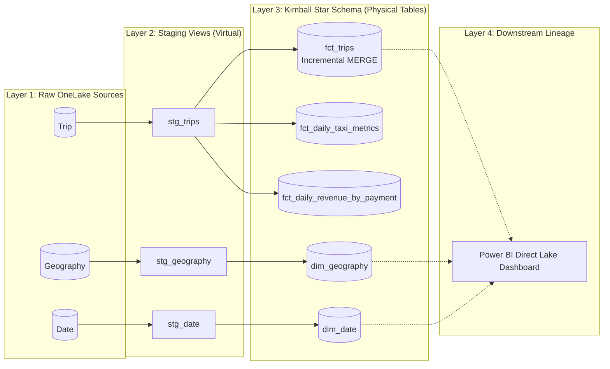

# Microsoft Fabric + dbt Core: Enterprise Analytics Engineering

[](https://www.getdbt.com/)
[](https://github.com/microsoft/dbt-fabric)
[](https://fabric.microsoft.com/)
[](https://opensource.org/licenses/MIT)

An enterprise-grade analytics engineering repository modernizing SQL pipelines using **dbt Core** on **Microsoft Fabric Synapse Data Warehouse**.

This project accompanies the 6-part publication series:  
**_From SQL Analyst to Analytics Engineer: A Real-World Microsoft Fabric & dbt Journey_**.

---

## 📖 The 6-Part Publication Arc & Git Release Tags

Each article in the series corresponds directly to a tagged release in this repository. You can check out any stage of the architecture using Git tags:

| Release Tag | Series Part | Architecture Milestone |
| :--- | :--- | :--- |
| [`v1.0-ephemeral`](https://github.com/double-espresso-data/fabric-dbt-engineering/releases/tag/v1.0-ephemeral) | **Part 1: The Analyst** | Read-only ephemeral CTE models, `sources.yml`, and Python CSV automation (`export.py`). |
| [`v2.0-fabric-setup`](https://github.com/double-espresso-data/fabric-dbt-engineering/releases/tag/v2.0-fabric-setup) | **Part 2: Fabric Warehouse** | Provisioning Fabric Synapse DWH, Entra ID SSO, directory materialization, and staging views. |
| [`v3.0-testing-docs`](https://github.com/double-espresso-data/fabric-dbt-engineering/releases/tag/v3.0-testing-docs) | **Part 3: Production Quality** | Generic schema tests (`unique`, `not_null`), `dbt build` circuit-breakers, and documentation. |
| [`v4.0-kimball-powerbi`](https://github.com/double-espresso-data/fabric-dbt-engineering/releases/tag/v4.0-kimball-powerbi) | **Part 4: Kimball Star Schema** | Conformed dimensions (`dim_date`, `dim_geography`), fact models, and Power BI `exposures.yml`. |
| [`v5.0-jinja-macros`](https://github.com/double-espresso-data/fabric-dbt-engineering/releases/tag/v5.0-jinja-macros) | **Part 5: Pythonic SQL** | Reusable `to_dollars` macro in `macros/`, Jinja loops, and dynamic payment pivoting. |
| [`v6.0-incremental-merge`](https://github.com/double-espresso-data/fabric-dbt-engineering/releases/tag/v6.0-incremental-merge) | **Part 6: Big Data Scale** | Incremental fact loading on `fct_trips` with native Fabric `MERGE` and lookback window. |

To jump to a specific milestone:
```bash
git checkout v3.0-testing-docs
```

---

## 🏛️ Architecture Overview

The data warehouse transforms the **NYC Taxi & Limousine Commission** dataset into a star schema optimized for Power BI Direct Lake reporting:



---

## 📁 Repository Structure

```text
fabric-dbt-engineering/
├── macros/
│   └── to_dollars.sql                     # Compile-time currency formatting macro
├── models/
│   ├── sources.yml                        # Fabric raw table definitions (Trip, Geography, Date)
│   ├── schema.yml                         # Generic quality assertions (unique, not_null)
│   ├── exposures.yml                      # Downstream Power BI semantic model lineage
│   ├── staging/
│   │   ├── stg_date.sql                   # Calendar staging view
│   │   ├── stg_geography.sql              # Geographic zones staging view
│   │   └── stg_trips.sql                  # Cleaned taxi rides staging view
│   └── marts/
│       ├── dim_date.sql                   # Conformed calendar dimension table
│       ├── dim_geography.sql              # Conformed geography dimension table
│       ├── fct_trips.sql                  # Incremental fact table with native MERGE
│       ├── fct_daily_taxi_metrics.sql     # Aggregated daily business metrics
│       └── fct_daily_revenue_by_payment.sql # Dynamic Jinja-pivoted revenue matrix
├── dbt_project.yml                        # Project configuration & materialization inheritance
└── .gitignore                             # Secret & artifact isolation
```

---

## 🚀 Getting Started

### 1. Prerequisites
- **Python:** 3.10, 3.11, or 3.12+
- **ODBC Driver:** [ODBC Driver 18 for SQL Server](https://learn.microsoft.com/en-us/sql/connect/odbc/download-odbc-driver-for-sql-server) *(required for Microsoft Fabric TDS endpoint)*
- **Microsoft Fabric Capacity:** Synapse Data Warehouse provisioned with the 1-click **Sample warehouse** (NYC Taxi data).

### 2. Environment Setup
Clone the repository and create an isolated virtual environment:

```bash
# Clone the repository
git clone https://github.com/double-espresso-data/fabric-dbt-engineering.git
cd fabric-dbt-engineering

# Create and activate a Python virtual environment
python -m venv .venv

# Windows (PowerShell)
.venv\Scripts\Activate.ps1

# macOS / Linux
source .venv/bin/activate

# Install dbt Core and the Microsoft Fabric adapter
pip install --upgrade pip
pip install dbt-core==1.12.6 dbt-fabric==1.11.1
```

---

## 🔐 Credentials & Connection (`profiles.yml`)

> [!IMPORTANT]
> **Zero Credentials in Code:**  
> This repository contains **NO** passwords, secrets, connection strings, or tenant IDs.  
> dbt securely isolates all connection credentials in your home directory: `~/.dbt/profiles.yml`.

Create or update your local `~/.dbt/profiles.yml` file (`C:\Users\<your-username>\.dbt\profiles.yml` on Windows):

```yaml
fabric_project:
  target: dev
  outputs:
    dev:
      type: fabric
      driver: 'ODBC Driver 18 for SQL Server'
      server: <your-fabric-workspace-guid>.datawarehouse.fabric.microsoft.com
      port: 1433
      database: dbt_learning_wh
      schema: dbo
      authentication: ActiveDirectoryInteractive
      threads: 4
      trust_cert: true
      encrypt: true
```

### Why `ActiveDirectoryInteractive`?
- **No Stored Passwords:** Uses Microsoft Entra ID (Azure AD) Single Sign-On.
- **MFA Compliant:** Automatically prompts your default web browser for corporate Multi-Factor Authentication.
- **Token Cache:** Authenticates once and caches the MSAL token for seamless CLI execution.

---

## ⚡ Essential Commands

Test your connection:
```bash
dbt debug
```

Compile models and inspect generated T-SQL in `target/compiled/`:
```bash
dbt compile
```

Run the entire pipeline (seeds, models, tests, exposures) in topological order:
```bash
dbt build
```

Run incremental fact processing with full disaster recovery rebuild:
```bash
dbt run --select fct_trips --full-refresh
```

Generate and serve interactive data documentation & lineage graph:
```bash
dbt docs generate
dbt docs serve
```

---

## 🛡️ Data Quality & Circuit-Breaker Architecture

This project enforces strict contract validation before tables are promoted to Gold marts:
- **`unique` & `not_null`**: Primary keys are asserted on `fct_daily_taxi_metrics.date_id`.
- **Atomic Swaps (`__dbt_tmp`)**: Table models calculate in shadow tables and swap into production in <2ms, guaranteeing zero dashboard downtime.
- **Circuit Breaker**: When running `dbt build`, any upstream test failure immediately halts execution, preventing corrupt data from ever landing in production Power BI reports.

---

## 🤝 Contributing & Community
Created with ☕ by [double espresso](https://github.com/double-espresso-data).  
Feel free to open an issue or pull request if you run into any quirks or have suggestions!
